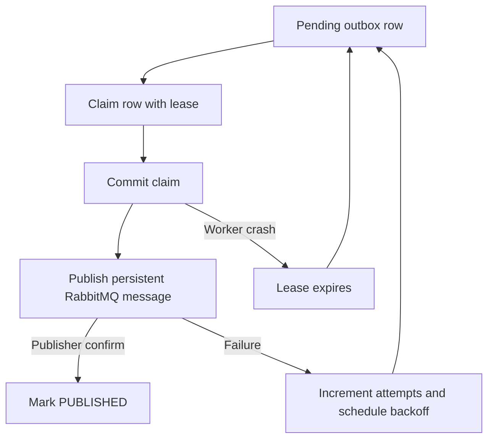

# Messaging and Transactional Outbox

## Why the outbox exists

The wallet update and the event publication cannot be safely implemented as two unrelated writes. Publishing before the database commit can announce a transaction that later rolls back. Publishing after commit without a durable record can lose an event if the process crashes between the two operations.

The transaction service therefore inserts `outbox_events` in the same MySQL transaction as the wallet balance, transaction, ledger and idempotency response.

## Publisher lifecycle

The publisher claims rows with `SELECT ... FOR UPDATE SKIP LOCKED`, commits a lease, publishes outside the SQL transaction, then records success or retry. A crashed publisher leaves a lease that can expire and be reclaimed.

## Delivery guarantee

Delivery is at least once. If RabbitMQ confirms a message and the publisher crashes before marking the outbox row as published, the event can be sent again. Consumers must deduplicate using `event_uuid`.

The example consumer writes `(consumer_name, message_uuid)` to `processed_messages` before invoking its handler and commits both in one transaction. For real consumers, the business side effect must share that transaction. If the side effect is an external HTTP request, the downstream service must support idempotency or a separate outbox/inbox workflow.

Invalid or failed consumer messages are dead-lettered for investigation. This reference does not implement automatic consumer retry queues or a replay console.
