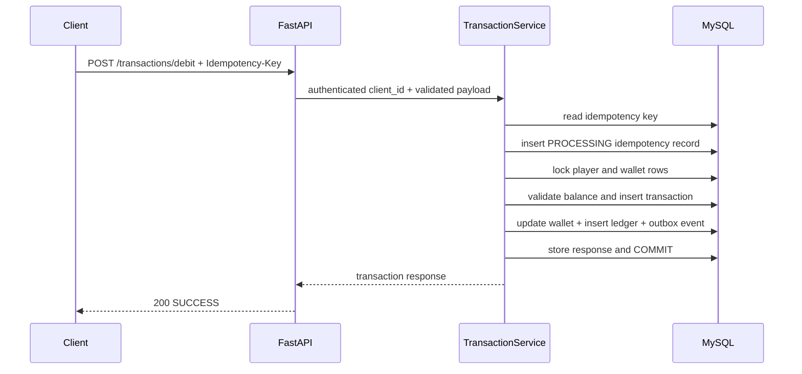

# Wallet Transaction Lifecycle

## Debit

## Transaction types

| Type | Balance effect | Parent transaction |
|---|---|---|
| DEBIT | Decrease | None |
| CREDIT | Increase | None |
| REFUND | Increase | Original successful DEBIT; partial refunds allowed |
| ROLLBACK | Reverse original DEBIT/CREDIT in full | Original successful DEBIT or CREDIT; no prior reversal allowed |
| ADJUSTMENT | Increase or decrease | None; reason required |

Every successful operation creates a new transaction and a new ledger row. Refunds and rollbacks never overwrite the original financial record.

## Idempotency

The unique key is `(client_id, idempotency_key)`. The request hash includes the operation and canonicalized payload.

- Same key + same request: return the previously stored response.
- Same key + different request: return `409 IDEMPOTENCY_CONFLICT`.
- Business-rule failure: store the failure response against the key; wallet balance and ledger remain unchanged.
- Unexpected database failure: roll back the complete unit of work, including the idempotency row.

Concurrent duplicate inserts are arbitrated by the unique constraint. The losing transaction rolls back and reads the committed winner.

## Refund and rollback safeguards

The original transaction row is locked before checking child reversals. Child transactions are read using a locking/current read so MySQL `REPEATABLE READ` snapshots cannot hide a just-committed refund. Cumulative refunds cannot exceed the original debit amount. A rollback is rejected if any successful refund or rollback already exists.
